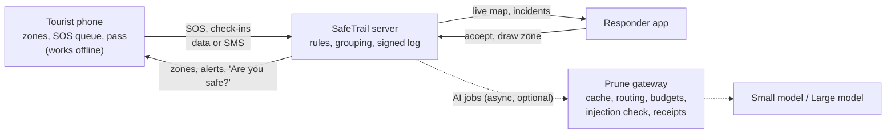

# SafeTrail explained (for the team)

Read this before you present. It's written for beginners: what each part does, why we need it, and how to say it to a judge. SPEC.md has the full detail; HANDOFF.md says what's built.

## The story in 10 lines

1. Tourists and pilgrims on treks like Kedarnath get caught by landslides, floods and crowd crushes.
2. Three things fail at once: nobody warns them, there's no signal, and they can't explain themselves to local responders.
3. SafeTrail is one installable app with a tourist mode and a responder mode.
4. The tourist's phone holds the danger zones and warns them before they walk in, even with no internet.
5. SOS is one hold of a button. It's saved on the phone at once and sent on the first bar of signal, by SMS if data is down.
6. Responders see one grouped incident instead of 40 confused calls, with exact counts and a report in their language.
7. When an officer accepts, the tourist sees "Help acknowledged", and every step goes into a signed log nobody can quietly edit.
8. AI only writes and translates: safety packs, zone warnings, reports, summaries, next steps.
9. Every AI call goes through Prune, which picks the cheapest model that works, reuses answers we've already paid for, and caps spending.
10. If the AI is down or over budget, standard text is used and every safety feature keeps working.

The dotted lines are the AI. Everything on the solid lines works without it.

## Each part in three sentences

**Geofence (on the phone).** The phone checks its GPS position against the danger zones it downloaded at the start of the trip. We need it because alerts must work in a dead zone, where nothing can reach the server. To a judge: "Your phone carries the map of danger with it, so it can warn you with no signal."

**Offline SOS queue.** Pressing SOS saves the alert on the phone with its own ID, then retries until it reaches the server, by SMS if mobile data is down. We need it because many trails have long stretches without signal. To a judge: "It's a letter in the postbox: it leaves the moment the postman (signal) arrives."

**SOS grouping (server, no AI).** A new SOS joins the nearest open incident within 150 m from the last 30 minutes, and incidents that drift close together merge. We need it so responders see one picture with exact counts instead of a flood of calls. To a judge: "Plain code counts the people, so the numbers are always exact; the AI only writes the summary."

**Crowd engine (server, no AI).** It counts tourist dots in 25 m squares and turns a square red when it's near its safe capacity. We need it because crowd crushes build up before anyone notices. To a judge: "We see the crowd from the dots alone and warn people heading into it."

**Zone warnings and safety packs (AI through Prune).** The AI writes the warning text and the offline pack in the tourist's language, from facts we give it. We need it because a pilgrim from Tamil Nadu and a trekker from Germany need different languages. To a judge: "The AI is a translator and writer, never a decision maker."

**Validators.** Every AI answer is checked against the facts we sent: no invented phone numbers, injuries, counts or places. We need them because a wrong number in an emergency is worse than no text. To a judge: "If the AI invents a fact, we reject the answer, ask once more, and then fall back to standard text."

**Template fallback.** Every AI feature has a fixed standard text that's used when the AI is off, slow or over budget. We need it so safety never depends on the AI. To a judge: "It's the printed sign for when the loudspeaker fails."

**Prune gateway.** One base URL in front of every AI call that adds caching, routing to cheaper models, run budgets, injection detection, a PII shield and signed receipts. We need it to keep AI cost in paise and to stop failures running up the bill. To a judge: "Prune is a toll booth with a budget meter in front of the AI."

**Signed, hash-chained log.** Each event (SOS sent, received, accepted) is chained to the one before with a hash and signed with our key. We need it so nobody can quietly change what happened and when. To a judge: "Diary pages stapled together, so tearing one out shows."

**Digital tourist pass.** A QR code signed with our private key; any checkpoint can check it offline with the public key. We need it to tie the trip to the permit people already have, without exposing personal data. To a judge: "Like a ticket with a tamper seal: change one letter and the seal breaks."

**Weather (Open-Meteo, no AI).** We fetch the forecast for each section of the trail and turn it into warnings with fixed thresholds, such as 7.6 mm of rain per hour counting as heavy rain (the IMD threshold). We need it because rain and snow come before landslides and frostbite. To a judge: "Weather suggests, the officer decides: one tap draws a zone, but a person publishes it."

**Family link.** A private link that shows only the trip status and the last check-in time. We need it so families worry less without turning SafeTrail into tracking. To a judge: "Your family sees 'On trip, last check-in 2 min ago', never where you are."

**Benchmark (`/benchmark`).** The same simulated scenario runs four ways: naive, SafeTrail without Prune's optimisations, SafeTrail with Prune cold, and the same again warm. We need it because the judges score cost, and every number must be measured. To a judge: "Here's what each layer saved, measured on the same 500 trips, with Prune's signed receipts."

## Glossary

| Term | Plain meaning |
|---|---|
| Geofence | An invisible fence on the map. The phone checks whether it's inside. |
| Hysteresis | Waiting for 2 readings inside (3 to leave) before alerting, so a jumpy GPS doesn't make the phone buzz on and off. |
| PWA | A website you can install like an app. It works offline after the first visit. |
| IndexedDB | The storage inside the browser where the phone keeps the SOS queue and the safety pack. |
| SSE | Server-Sent Events: the server pushes live updates to the screen without it asking. |
| Grouping (like DBSCAN) | Putting SOS alerts that are close in space and time into one incident. We use a simpler distance rule (150 m, 30 min) that works the same way for this. |
| Exact cache | Prune reuses an answer only when the request is identical, so you never get another incident's report. |
| Routing | Prune sends an easy request to a cheaper model when it can. |
| Run budget | A prepaid card for one AI job. When it's used up, Prune stops that job and we use standard text. |
| Receipt | A record of each AI call, signed by Prune, that anyone can verify on withprune.com/verify. |
| Hash chain | Each log entry includes a fingerprint of the previous one, so editing an old entry breaks every later one. |
| Ed25519 | The signature method we use for passes and the log (fast, small keys). |
| Template fallback | Fixed standard text used when the AI can't be used. |
| Prompt injection | Text that tries to give the AI orders, like "ignore previous instructions". |
| PII | Personal data: names, phone numbers, passport or permit numbers. It never goes into a prompt. |
| Nonce | A random tag in the prompt. A new one makes a "cold" benchmark run that can't reuse old cached answers. |
| Validator | Code that checks an AI answer only uses facts we sent. |
| Governor | Our own budget check before each AI call: if the estimate is over the job's budget, we don't call. |

## Judge questions, in our words

- **"Why not just call 112?"** 112 responds after something happens. We warn before it happens, work without a shared language, keep the SOS when there's no signal, and give responders one grouped picture. We work alongside 112.
- **"Does it work with no network?"** Warnings, the safety pack and saving the SOS work offline. Sending needs some signal: data, SMS or a checkpoint. We never claim more.
- **"Is the AI deciding emergencies?"** No. Rules set priority, and plain code counts people and runs zones. The AI only writes and translates, and validators stop it inventing facts.
- **"Is the 'without Prune' number real?"** There are two numbers. One is measured: R2 against R3, the same design with Prune's routing and cache off and on. The other is Prune's own list-price estimate, always labelled as an estimate.
- **"Why exact cache, not semantic?"** Correctness. A similar-sounding note from a different incident must never return someone else's report. Our prompts are designed so identical situations produce identical requests.
- **"Why detect injections instead of blocking them?"** Blocking would drop the report for a real SOS that happens to contain odd text. Detecting turns it into a flag, and priority never depends on the AI. Our own scanner only understands English tricks; Prune's detection covers the rest, and the benchmark measures both.
- **"Isn't this surveillance?"** It's opt-in per trip, with a Stop button, location history deleted after 7 days, and family see status only.
- **"Can GPS be faked?"** We flag impossible jumps, replayed SOS and forged passes. We don't claim to stop all spoofing.
- **"Is the report an FIR?"** No, it's an incident report draft. FIRs follow police procedure.
- **"What about Aadhaar or visas?"** That's Phase 2: the pass links to the permit each traveller already has (e-Visa, e-ILP, yatra registration). Aadhaar is never required.

## What we deliberately did NOT build, and why

- **Real 112 integration:** it needs official authorisation. We show where it would plug in.
- **Real permit APIs (e-ILP, PAP/RAP, yatra registration, DigiLocker):** there's no open API for a hackathon, so the permit check is simulated and labelled.
- **Face recognition:** not needed for safety, and a privacy risk.
- **Satellite SOS and phone-to-phone Bluetooth relay:** they need hardware and platform access we don't have. They're future work.
- **A chatbot:** there is no chat box anywhere. Tourists in trouble need buttons, not a conversation.
- **Semantic caching:** it could return the wrong incident's report (see above).

## The 30-second explanation (everyone learns this)

> "SafeTrail is a safety app for treks, pilgrimages and parks. Your phone warns you before you walk into a landslide zone or a dangerous crowd, even offline. If you're in trouble, SOS is saved instantly and sent on the first signal. Responders see one clear, grouped incident and accept it, and every step is signed so nobody can rewrite it. AI only writes and translates, every AI call goes through Prune to keep it to paise per trip, and if the AI fails, safety keeps working."
